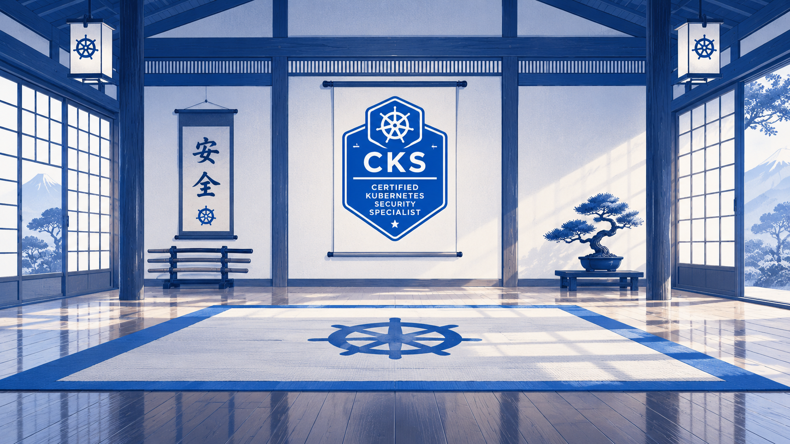

  

# cks-dojo

A minimal, local CKS (Certified Kubernetes Security Specialist) exam simulator,
inspired by [ckad-dojo](https://github.com/TiPunchLabs/ckad-dojo). No CLI, no
web UI - just questions, an idempotent setup script, and bash-based scoring,
run against a dedicated multi-node minikube cluster.

## Quick start

1. Read [PREREQUISITES.md](PREREQUISITES.md) and start the cluster.
2. `./cks-dojo.sh 1 setup`
3. Solve each question in `./exam/course/<question-number>/` (see
   `exams/cks-simulation1/questions.md`). All paths in the questions are
   relative to the repo root.
4. `./cks-dojo.sh 1 score`
5. Stuck? Check `exams/cks-simulation1/solutions.md`.

Prefer running things directly? `cd exams/cks-simulation1 && ./setup.sh` /
`./run-scoring.sh` still works exactly as before - `cks-dojo.sh` is a thin
convenience wrapper, not a replacement.

## What's here

- `exams/cks-simulation1/` - 11 questions across all six CKS curriculum domains
  (Cluster Setup, Cluster Hardening, System Hardening, Minimize Microservice
  Vulnerabilities, Supply Chain Security, Monitoring/Logging/Runtime Security).
  92 points total, ~66% (61 points) to pass.
- `scripts/lib/common.sh` - shared print/scoring helpers used by every exam.

## Known limitations (v1)

- Targets multi-node minikube + Calico only (see PREREQUISITES.md). Other
  cluster targets aren't supported yet.
- No AppArmor questions - seccomp is used instead, since it works identically
  across all supported hosts (see PREREQUISITES.md for why).
- No full CLI or web UI (`cks-dojo.sh` only forwards to the exam's setup and
  scoring scripts). No automated timer; self-time against the 120 minutes
  noted in `exam.conf`.
